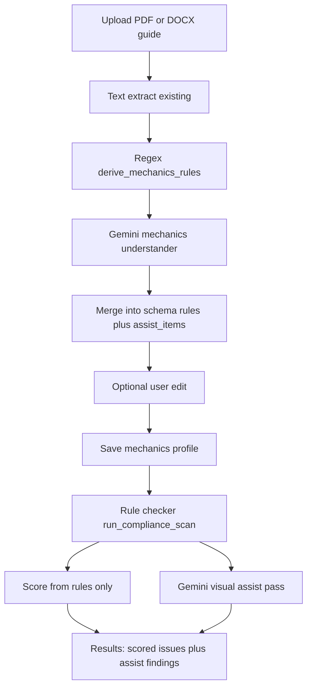

# PaperPilot v10.0.1 — Dynamic Mechanics + Gemini Assist (Team Handoff)

**Status:** Implemented on branch `release/v10.0.1` (Nov 2026).  
**Repo:** PaperPilot (`PaperPilot-main/`)  
**Do not merge into `mobile-main` until product decides.**

---

## Goal

1. **Dynamic Format Mechanics** — User uploads their own PDF/DOCX guide or researcher template. Gemini understands it and fills structured Format Fields. User edit is **optional** (Save as-is is fine).
2. **Visual / image rules** — Mark cases the rule engine cannot fully verify for **Gemini assist**. Assist never changes the numeric score.
3. **Ship as v10.0.1** on a new branch from **`main`**.

---

## Locked product decisions

| Topic | Decision |
|--------|----------|
| Schema | Gemini fills **existing** Format Fields so the rule checker still scores |
| Non-schema rules | Stored as `assist_items` (visual / image / style / other) |
| User edit after extract | **Optional** — primary CTA: Save & use as-is |
| Score ownership | **100% rule checker** (`run_compliance_scan`) |
| Gemini role | Assisted only: (a) understand mechanics on extract, (b) visual assist on scan, (c) existing issue wording enrichment |
| If Gemini off | Extract + scan still work; assist section shows unavailable |
| ACM template sample | Grounding only — **never** hardcode ACM in product logic |

---

## Context (what exists today)

- Mechanics already accept **PDF/DOCX**, extract → editable fields → save (Firebase RTDB + optional S3 sidecar).
- Extract today: regex `derive_mechanics_rules` + optional local ML `enrich_mechanics_rules` — **not** Gemini yet.
- Scan score: deterministic checklist in `compliance.py`. Gemini currently only rewrites issue wording / may nudge severity one step — does **not** invent issues or change score. See `docs/HOW_PAPERPILOT_SCAN_WORKS.md`.
- Weak spots: researcher/template guides that don’t match regex; rich figure/image rules; `assert_mechanics_guide` can reject long template-shaped docs as “manuscripts.”

### Useful sample (fixture only)

`docs/acm_template.docx` (ACM submission template) is one real-world shape:
- Template-as-guide (Word styles + narrative), not a clean “Margins: 1 inch” list
- Rich figure/table/image instructions
- Embedded example images in `word/media/`

Every user will upload **their own** guide. Design for:
- Explicit rulebook (school outline / APA-style fields)
- Template-as-guide (ACM-like)
- Hybrids

Use ACM only as **one test fixture among others** — no ACM-only branching in production.

---

## Branch / version

```bash
git checkout main
git pull origin main
git checkout -b release/v10.0.1
```

Bump version to **`10.0.1`** in:
- `PaperPilot-main/package.json`
- `PaperPilot-main/web/package.json`
- `PaperPilot-main/mobile/package.json`
- `PaperPilot-main/mobile/app.json` → `"version": "10.0.1"`

---

## Architecture



---

## Implementation todos

### 1. Branch + version bump
- Create `release/v10.0.1` from `main`
- Bump packages/app to `10.0.1`

### 2. Gemini mechanics understander (dynamic extract)
- Add `understand_mechanics_with_gemini(text, seed_rules) -> { rules, assist_items, confidence, guide_kind }`
  - Prefer new module `api/app/mechanics_gemini.py` or extend `api/app/gemini_client.py`
- Prompt must be **publisher-agnostic**
- Map into existing schema when possible
- Non-schema → `assist_items` with `kind`: `visual` | `image` | `style` | `other`, `assist_required: true`
- Wire into `POST /mechanics/extract` in `api/app/main.py` **after** regex/ML
- Fallback: if no `GEMINI_API_KEY`, keep regex/ML only
- Soften `assert_mechanics_guide` in `api/app/documents.py` for template-as-guide (instruction + style vocabulary) without ACM-specific rules
- Persist `assist_items` via `api/app/compliance_db.py` (RTDB + S3 sidecar)
- Still run `normalize_mechanics_rules` so checker stays schema-safe

Example `assist_items` shape:

```json
{
  "id": "assist_figure_alt_text",
  "category": "figure_layout",
  "requirement_text": "Every figure must have alt-text / figure description",
  "kind": "image",
  "assist_required": true
}
```

### 3. Optional edit UX (web + mobile)
- Keep Format Fields UI (`web/src/components/cockpit/MechanicsPanel.jsx` + mobile equivalent)
- After extract: **Review (optional)** + primary **Save & use as-is**
- Show `assist_items` as read-only chips (“Checked with AI assist on scan”)
- Update API clients (`web/src/api.js` / mobile)

### 4. Independent Gemini visual assist on scan
- After rule scan + existing wording enrichment, call a **new** assist function with only marked `assist_items` + relevant caption/image snippets
- Scan result adds `assist_findings: [...]` **separate from** `issues`
- **Never** feed assist findings into scoring / unit counts
- Existing `enrich_compliance_issues` stays as-is (sibling helper)

### 5. Docs + tests
- Update `docs/HOW_PAPERPILOT_SCAN_WORKS.md`: Gemini also helps *read* mechanics; visual assist never scores
- Tests (Gemini mocked):
  - Extract → schema fill + `assist_items`
  - Scan with assist → findings present, score unchanged if assist flips
  - Gemini off → graceful degrade
- Fixtures: school outline + optional ACM-like template (not production branching)

---

## Out of scope for v10.0.1

- Gemini inventing new **score-affecting** rule types
- OCR for fully scanned image-only guides (still need text-based PDF/DOCX)
- Changing core checklist math / Right–Incorrect scoring

---

## Key files

| Path | Role |
|------|------|
| `api/app/main.py` | `/mechanics/extract`, save routes |
| `api/app/documents.py` | `derive_mechanics_rules`, `assert_mechanics_guide` |
| `api/app/mechanics_ml.py` | Local ML fill (keep as fallback) |
| `api/app/gemini_client.py` | Existing Gemini; add understand + visual assist (or new `mechanics_gemini.py`) |
| `api/app/compliance.py` | `run_compliance_scan`, `_check_captions` |
| `api/app/compliance_db.py` | Persist mechanics + `assist_items` |
| `api/app/schemas.py` | Request bodies — extend for `assist_items` if needed |
| `web/src/components/cockpit/MechanicsPanel.jsx` | Mechanics UI |
| `web/src/api.js` | Client API |
| `mobile/...` | Parallel Mechanics UI / API |
| `docs/HOW_PAPERPILOT_SCAN_WORKS.md` | User-facing scan explanation |

Env already used: `GEMINI_API_KEY`, `GEMINI_MODEL` (default `gemini-2.0-flash`) in API / ML service config.

---

## Prompt for the other Cursor agent

Paste something like:

> Implement PaperPilot **v10.0.1 Dynamic Mechanics + Gemini Assist** per `docs/HANDOFF_v10.0.1_DYNAMIC_MECHANICS.md`.
>
> 1. Branch `release/v10.0.1` from `main`; bump versions to 10.0.1.
> 2. Add publisher-agnostic Gemini mechanics understander after regex/ML extract; persist `assist_items`; soften `assert_mechanics_guide` for template-as-guide docs.
> 3. Make Format Fields edit optional (Save as-is).
> 4. Add independent Gemini visual assist on scan; `assist_findings` must never change score.
> 5. Update HOW_PAPERPILOT_SCAN_WORKS.md + mocked tests.
>
> Do not hardcode ACM. Do not change scoring math. Keep the rule checker independent of Gemini.

---

## One-sentence reminder

**Rules find and score; Gemini understands guides and assists on visual gaps; the user may edit mechanics but does not have to.**
